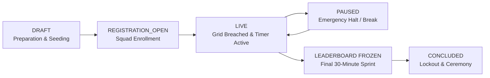

# ADMIN COMMAND SOC & EVENT OPERATIONS: HACK THE GRID

This document defines the administrative tools, God-mode controls, and event operation workflows for organizers from CodeSphere Coding Club at Tula's University.

---

## 1. Administrative Capabilities Overview

The Admin Command SOC (`/admin`) provides full visibility and control over the CTF event:

1. **Dashboard Telemetry**: Real-time aggregation of registered squads, operative counts, active challenges, question pool variations, submissions volume, and overall accuracy percentages.
2. **Team Roster Management**: Inspect all teams, view team join codes (for stranded participants), view members list, and execute one-click disqualifications.
3. **Challenge Engine & Question Pool**: Define stage levels (1 to 10), assign base point rewards, toggle physical QR requirement, and add question variations to the randomized pool.
4. **QR Checkpoint Beacon Manager**: Register campus beacons, review calculated HMAC signatures, and generate printable scan URLs for campus placement.
5. **Submission Forensics**: Live paginated stream of all attempts showing team, operative, level, submitted value, result, and IP address.
6. **Master Event Controls**: Real-time toggle of event states (`DRAFT`, `LIVE`, `PAUSED`, `CONCLUDED`) and scoreboard freeze switch (`isLeaderboardFrozen`).

---

## 2. Event Lifecycle Management Protocols

### Protocol Guidelines
- **Event Launch**: Shift state to `LIVE` via `/admin/controls`. The countdown clock syncs across all operative HUDs.
- **Emergency Halt**: If a physical campus issue occurs (e.g. weather, power), toggle `PAUSED`. All flag submissions and checkpoint scans will temporarily halt.
- **Leaderboard Freeze**: 30 minutes before cutoff, toggle `FREEZE SCOREBOARD`. Participant and public views lock to the frozen snapshot.
- **Lockdown**: At conclusion, toggle `CONCLUDED`. All flag submission endpoints lock permanently.

