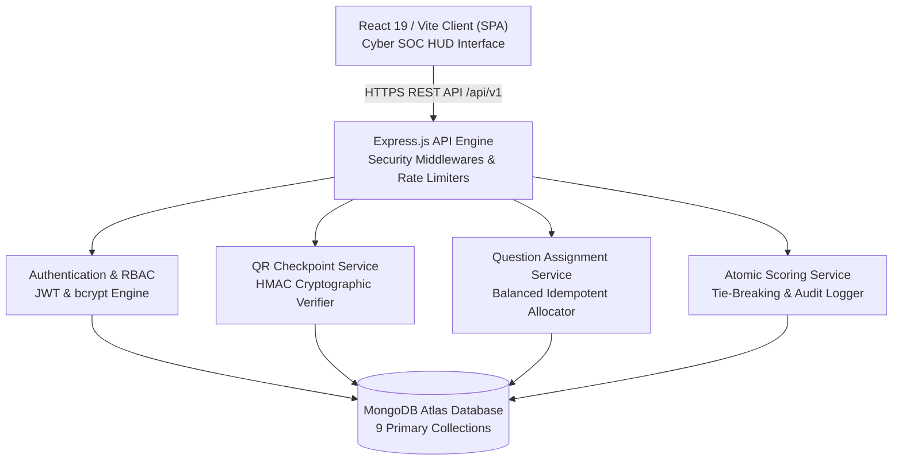
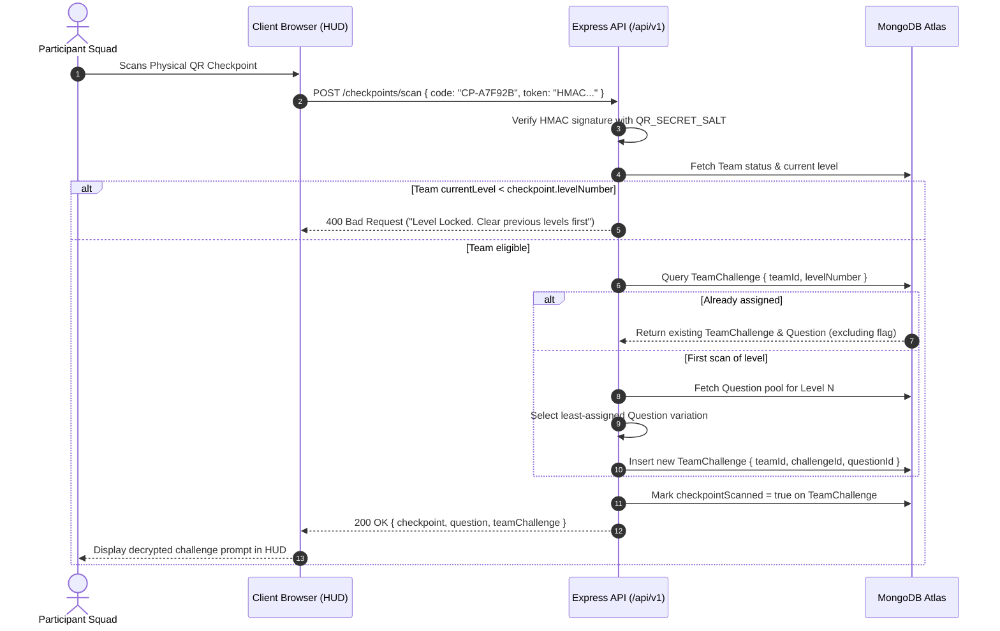
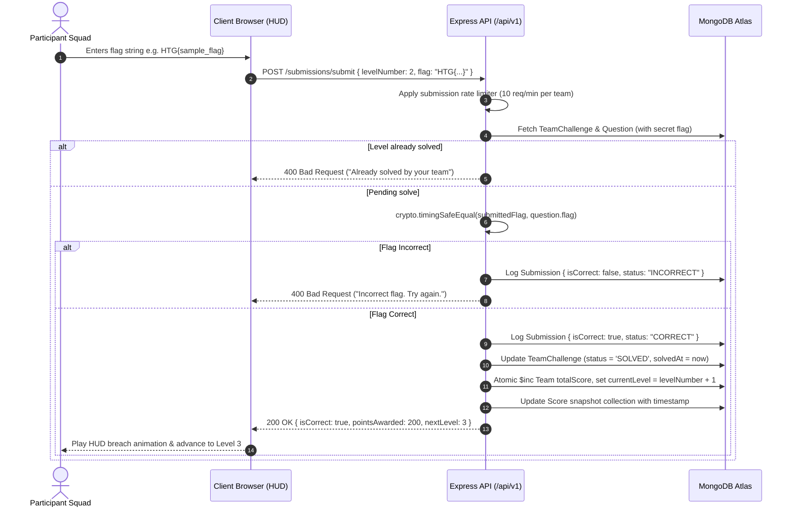

# SYSTEM ARCHITECTURE SPECIFICATION: HACK THE GRID

This document defines the high-level and component architecture of the **Hack the Grid** platform.

---

## 1. System Topology Overview

Hack the Grid is organized into distinct decoupled tiers:

---

## 2. End-to-End Operational Sequence Flows

### A. Physical QR Scan & Persistent Question Assignment Flow

---

### B. Flag Submission & Atomic Scoring Flow

---

## 3. Architecture Principles

1. **Zero Client-Side Trust**:
   - The browser never receives flags, answers, or verification logic.
   - All comparisons occur server-side inside constant-time routines (`crypto.timingSafeEqual`).
2. **Deterministic Idempotency**:
   - Every team-specific question assignment is stored in the database.
   - Any repeated request, reload, or duplicate QR scan returns the exact same question record.
3. **Stateless Scalability**:
   - Authentication is powered by self-contained JWT tokens.
   - The API server maintains no in-memory session state, allowing horizontal scaling across multiple instances (Render/Railway/AWS).
4. **Performance Optimized Scoring**:
   - Leaderboard standings are served from pre-indexed snapshots in the `scores` collection (`{ currentScore: -1, lastSolveTimestamp: 1 }`), preventing heavy table scans during high-traffic competition bursts.
