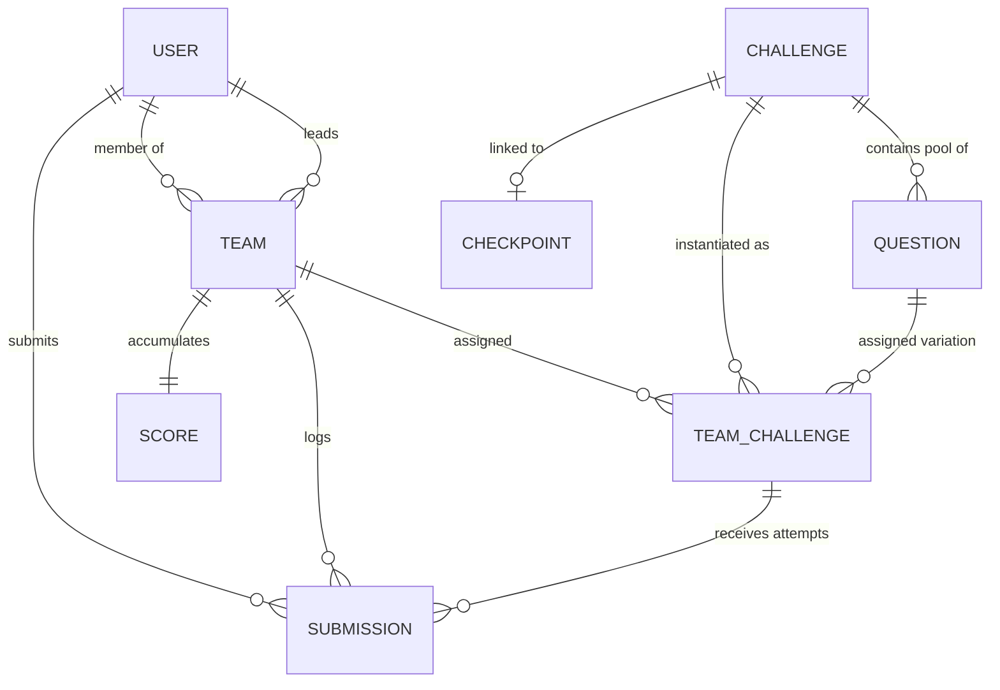

# DATABASE SCHEMA SPECIFICATION: HACK THE GRID

This document defines the complete MongoDB database model, entity relationships, compound indexes, constraints, and security validations for **Hack the Grid**.

---

## 1. Entity Relationship Diagram (ERD)

---

## 2. Collections & Field Specifications

### 2.1. `users` Collection
Represents registered participants, team leaders, and administrators.

| Field | Type | Attributes / Constraints | Description |
|---|---|---|---|
| `_id` | ObjectId | Primary Key | Auto-generated document ID |
| `username` | String | Required, Unique, Trim, Min: 3, Max: 30 | Alphanumeric handle (callsign) |
| `email` | String | Required, Unique, Trim, Lowercase | Valid email address |
| `passwordHash` | String | Required, `select: false` | bcrypt hashed password (salt 10) |
| `fullName` | String | Required, Trim | Legal name of participant |
| `phone` | String | Optional, Trim | Contact telephone number |
| `collegeRollNo`| String | Optional, Trim | University student ID |
| `role` | String | Enum: `['ADMIN', 'TEAM_LEADER', 'TEAM_MEMBER']`, Default: `TEAM_MEMBER` | Role-based authorization |
| `teamId` | ObjectId | Ref: `Team`, Default: `null`, Indexed | Associated squad |
| `isActive` | Boolean | Default: `true` | Account activation state |
| `lastLoginAt` | Date | Default: `null` | Most recent login timestamp |
| `createdAt` | Date | Timestamp | Document creation timestamp |
| `updatedAt` | Date | Timestamp | Document last update timestamp |

**Indexes**:
- `{ username: 1 }` (Unique)
- `{ email: 1 }` (Unique)
- `{ teamId: 1 }`
- `{ role: 1 }`

---

### 2.2. `teams` Collection
Represents participating squads (2 to 4 members).

| Field | Type | Attributes / Constraints | Description |
|---|---|---|---|
| `_id` | ObjectId | Primary Key | Auto-generated document ID |
| `name` | String | Required, Unique, Trim, Min: 3, Max: 40 | Squad callsign / name |
| `joinCode` | String | Required, Unique, Uppercase, Min: 6, Max: 10 | Secret team enrollment token |
| `leaderId` | ObjectId | Ref: `User`, Required, Indexed | Team captain / creator |
| `members` | Array[ObjectId] | Ref: `User`, Max items: 4 | Squad operative roster |
| `maxMembers` | Number | Default: `4`, Min: 2, Max: 4 | Enforced team size limit |
| `currentLevel` | Number | Default: `1`, Min: 1, Indexed | Active level squad is attempting |
| `totalScore` | Number | Default: `0`, Min: 0, Indexed | Cumulative score |
| `lastSolveTimestamp` | Date | Default: `null`, Indexed | Timestamp of most recent solve |
| `isDisqualified` | Boolean | Default: `false`, Indexed | Anti-cheat ban status |
| `disqualificationReason` | String | Default: `null` | Justification note from admin |
| `avatarUrl` | String | Optional | Custom team insignia URL |
| `createdAt` | Date | Timestamp | Registration timestamp |
| `updatedAt` | Date | Timestamp | Last update timestamp |

**Indexes**:
- `{ name: 1 }` (Unique)
- `{ joinCode: 1 }` (Unique)
- `{ totalScore: -1, lastSolveTimestamp: 1 }` (High-speed leaderboard sorting)

---

### 2.3. `challenges` Collection
Represents stage definitions (Levels 1 to ~10).

| Field | Type | Attributes / Constraints | Description |
|---|---|---|---|
| `_id` | ObjectId | Primary Key | Auto-generated document ID |
| `levelNumber` | Number | Required, Unique, Min: 1, Indexed | Level order (1 to 10) |
| `title` | String | Required, Trim | Stage name |
| `category` | String | Enum: `ALL_CHALLENGE_TYPES`, Required | Category (Crypto, Web, Stego, etc.) |
| `description` | String | Required | Stage narrative briefing |
| `points` | Number | Required, Default: `100`, Min: 0 | Base solve reward |
| `requiresCheckpointScan` | Boolean | Default: `true`, Indexed | Whether QR scan is required |
| `checkpointId` | ObjectId | Ref: `Checkpoint`, Default: `null`, Indexed | Linked campus beacon |
| `difficulty` | String | Enum: `['EASY', 'MEDIUM', 'HARD', 'EXPERT']` | Stage difficulty |
| `isActive` | Boolean | Default: `true`, Indexed | Availability state |

**Indexes**:
- `{ levelNumber: 1 }` (Unique)
- `{ isActive: 1, levelNumber: 1 }`

---

### 2.4. `questions` Collection
Question variations pool for each challenge level.

| Field | Type | Attributes / Constraints | Description |
|---|---|---|---|
| `_id` | ObjectId | Primary Key | Auto-generated document ID |
| `challengeId` | ObjectId | Ref: `Challenge`, Required, Indexed | Parent level container |
| `levelNumber` | Number | Required, Indexed | Parent level index |
| `title` | String | Required, Trim | Variation title (e.g. Variant A) |
| `prompt` | String | Required | Detailed problem markdown text |
| `category` | String | Required | Inherited category |
| `difficulty` | String | Default: `MEDIUM` | Difficulty rating |
| `flag` | String | Required, `select: false` | Secret flag string (`HTG{...}`) |
| `isCaseSensitive` | Boolean | Default: `true` | String comparison rule |
| `hints` | Array[Object] | `{ hintIndex, content, penaltyPoints }` | Unlocked hint clues |
| `assetUrls` | Array[String] | Optional | Downloadable files/stego images |
| `metadata` | Mixed | Default: `{}` | Algorithmic parameter values |
| `isActive` | Boolean | Default: `true`, Indexed | Available for pool selection |

**Indexes**:
- `{ challengeId: 1, isActive: 1 }`
- `{ levelNumber: 1, isActive: 1 }`

---

### 2.5. `teamchallenges` Collection (Core Pivot Model)
Maintains persistent, team-specific question allocations.

| Field | Type | Attributes / Constraints | Description |
|---|---|---|---|
| `_id` | ObjectId | Primary Key | Auto-generated document ID |
| `teamId` | ObjectId | Ref: `Team`, Required, Indexed | Target squad |
| `challengeId` | ObjectId | Ref: `Challenge`, Required, Indexed | Target stage |
| `levelNumber` | Number | Required, Indexed | Target level |
| `assignedQuestionId` | ObjectId | Ref: `Question`, Required, Indexed | Allocated question from pool |
| `status` | String | Enum: `['LOCKED', 'UNLOCKED', 'SOLVED']` | Stage completion status |
| `checkpointScanned`| Boolean | Default: `false` | True once QR verified |
| `checkpointScannedAt` | Date | Default: `null` | Scan timestamp |
| `unlockedAt` | Date | Default: `null` | Challenge unlock timestamp |
| `solvedAt` | Date | Default: `null`, Indexed | Timestamp flag was accepted |
| `solvedByUserId` | ObjectId | Ref: `User`, Default: `null` | Teammate who entered correct flag |
| `unlockedHints` | Array[Number] | Indices of unlocked hints | Deducted hint penalties |
| `penaltyIncurred` | Number | Default: `0` | Points deducted for hints |
| `attemptsCount` | Number | Default: `0` | Total submission attempts |
| `pointsAwarded` | Number | Default: `0` | Net points credited to squad |

**Compound Unique Constraints**:
- `{ teamId: 1, challengeId: 1 }` (UNIQUE) — Guarantees a team cannot have multiple assignments for the same challenge.
- `{ teamId: 1, levelNumber: 1 }` (UNIQUE) — Guarantees exactly one question per team per level.

---

### 2.6. `submissions` Collection
Audit paper trail for all verification attempts.

| Field | Type | Attributes / Constraints | Description |
|---|---|---|---|
| `_id` | ObjectId | Primary Key | Auto-generated document ID |
| `teamId` | ObjectId | Ref: `Team`, Required, Indexed | Squad making attempt |
| `userId` | ObjectId | Ref: `User`, Required, Indexed | Operative making attempt |
| `challengeId` | ObjectId | Ref: `Challenge`, Required, Indexed | Level attempted |
| `teamChallengeId`| ObjectId | Ref: `TeamChallenge`, Required, Indexed | Assigned pivot document |
| `questionId` | ObjectId | Ref: `Question`, Required | Variation attempted |
| `levelNumber` | Number | Required, Indexed | Level number |
| `submittedAnswer`| String | Required, Trim | Exact flag string submitted |
| `isCorrect` | Boolean | Required, Indexed | Validation result |
| `status` | String | Enum: `SUBMISSION_STATUS`, Required | Detailed audit status |
| `pointsDelta` | Number | Default: `0` | Points credited (if correct) |
| `ipAddress` | String | Optional | Origin client IP address |
| `userAgent` | String | Optional | Client browser User-Agent |
| `submittedAt` | Date | Timestamp, Indexed | Millisecond timestamp |

**Indexes**:
- `{ teamId: 1, challengeId: 1, submittedAt: -1 }`
- `{ submittedAt: -1 }` (Admin live feed streaming)

---

### 2.7. `checkpoints` Collection
Physical campus QR beacons.

| Field | Type | Attributes / Constraints | Description |
|---|---|---|---|
| `_id` | ObjectId | Primary Key | Auto-generated document ID |
| `levelNumber` | Number | Required, Unique, Indexed | Associated level index |
| `name` | String | Required, Trim | Beacon name |
| `locationDescription` | String | Required | Campus geographical coordinates |
| `checkpointCode` | String | Required, Unique, Uppercase, Indexed | Opaque identifier (e.g. `CP-A7F92B`) |
| `associatedChallengeId`| ObjectId | Ref: `Challenge`, Default: `null` | Associated stage |
| `isActive` | Boolean | Default: `true`, Indexed | Beacon operational state |
| `scanCount` | Number | Default: `0` | Total verified scans recorded |

**Indexes**:
- `{ checkpointCode: 1 }` (Unique)
- `{ levelNumber: 1 }` (Unique)

---

### 2.8. `scores` Collection
Real-time scoreboard snapshots.

| Field | Type | Attributes / Constraints | Description |
|---|---|---|---|
| `_id` | ObjectId | Primary Key | Auto-generated document ID |
| `teamId` | ObjectId | Ref: `Team`, Required, Unique, Indexed | Associated squad |
| `currentScore` | Number | Default: `0`, Indexed | Aggregated points |
| `solvedLevelsCount` | Number | Default: `0`, Indexed | Number of levels cleared |
| `totalPenalty` | Number | Default: `0` | Total deductions applied |
| `lastSolveTimestamp`| Date | Default: `null`, Indexed | Tie-breaker timestamp |
| `history` | Array[Object] | Solve log `{ levelNumber, pointsAwarded, solvedAt, submissionId }` | Timeline of solves |

**Indexes**:
- `{ teamId: 1 }` (Unique)
- `{ currentScore: -1, lastSolveTimestamp: 1 }` (Real-time rank sorting)

---

### 2.9. `eventconfigs` Collection
Global singleton event control document.

| Field | Type | Attributes / Constraints | Description |
|---|---|---|---|
| `_id` | ObjectId | Primary Key | Auto-generated document ID |
| `eventName` | String | Default: `"Hack the Grid"` | Event name |
| `organizer` | String | Default: `"CodeSphere Coding Club, Tula's University"` | Host organization |
| `state` | String | Enum: `EVENT_STATES`, Default: `DRAFT`, Indexed | Operational status |
| `startTime` | Date | Default: `null` | Event start timestamp |
| `endTime` | Date | Default: `null` | Event cutoff timestamp |
| `totalLevels` | Number | Default: `10` | Total stages in grid |
| `isLeaderboardFrozen` | Boolean | Default: `false` | Scoreboard freeze flag |
| `frozenAt` | Date | Default: `null` | Freeze start timestamp |
| `maxTeamSize` | Number | Default: `4` | Maximum allowable squad size |
| `minTeamSize` | Number | Default: `2` | Minimum allowable squad size |
