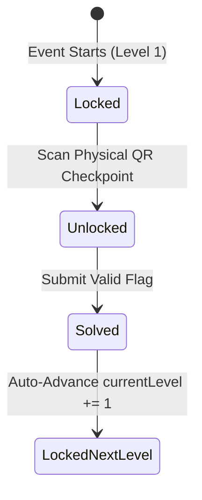

# GAMEPLAY LOGIC & ENGINE MECHANICS: THE TECH MYSTERY

This document defines the computational rules, progression state machine, question allocation algorithm, and scoring math for **The Tech Mystery**.

---

## 1. 10-Level Progression State Machine

The competition consists of 10 linear containment levels:
1. **Level 1**: Reconnaissance / OSINT / Web Inspection (Entry Gate)
2. **Level 2**: Binary & ASCII Representations
3. **Level 3**: Base64 & Multi-layer Encodings
4. **Level 4**: Client-side Script Inspection & Debugging
5. **Level 5**: Steganography & Hidden Payloads
6. **Level 6**: Algorithmic & Logical Reasoning Puzzles
7. **Level 7**: Classical & Modern Cryptanalysis
8. **Level 8**: Reverse Engineering & Fault Injection Simulation
9. **Level 9**: Multi-Stage Chained Cipher
10. **Level 10**: Master Flag Containment Breach

### Stage State Transition
Each level exists in one of three states for a given squad:
- `LOCKED`: Level $> \text{team.currentLevel}$, or level equals $\text{team.currentLevel}$ but physical QR checkpoint has not yet been scanned.
- `UNLOCKED`: Active challenge accessible. Operatives can view prompt, hints, download artifacts, and submit flags.
- `SOLVED`: Correct flag accepted. Level is permanently sealed for that team; points credited.



---

## 2. Team-Specific Question Assignment Algorithm

To prevent answer sharing between adjacent teams on campus:
1. Every level has a **Question Pool** containing $M \ge 3$ distinct question variations ($Q_1, Q_2, \dots, Q_M$) of equivalent difficulty.
2. When squad $T$ unlocks Level $L$, the engine runs a **Balanced Load Distribution Algorithm**:
   $$\text{Existing Assignments}(Q_i) = \text{count}(\text{TeamChallenge where } \text{assignedQuestionId} = Q_i)$$
   $$\text{MinCount} = \min_{1 \le i \le M} \left( \text{Existing Assignments}(Q_i) \right)$$
   $$\text{Candidate Pool} = \{ Q_i \mid \text{Existing Assignments}(Q_i) = \text{MinCount} \}$$
   $$\text{Assigned Question} = \text{UniformRandom}(\text{Candidate Pool})$$
3. **Persistence Rule**:
   Once assigned, the `(teamId, levelNumber)` tuple is committed to the `teamchallenges` collection with a compound unique index:
   ```javascript
   teamChallengeSchema.index({ teamId: 1, levelNumber: 1 }, { unique: true });
   ```
   Any subsequent refresh, browser crash, or re-scan queries `findOne({ teamId, levelNumber })` and returns the existing assignment.

---

## 3. Scoring Math & Formulas

### A. Level Solve Points
Each challenge level specifies a base point reward $P_{\text{base}}$:
- Levels 1–3 (Easy): 100 – 150 PTS
- Levels 4–7 (Medium): 200 – 300 PTS
- Levels 8–9 (Hard): 400 – 500 PTS
- Level 10 (Master Flag): 1000 PTS

### B. Hint Deductions
- Requesting an optional hint incurs a penalty $P_{\text{penalty}}$ (typically 20% of base points).
- The net points awarded upon solving are clamped to zero:
  $$P_{\text{net}} = \max\left(0, P_{\text{base}} - \sum P_{\text{penalty}}\right)$$

### C. Total Score Update (Atomic Transaction)
Upon correct flag validation:
$$\text{team.totalScore} \leftarrow \text{team.totalScore} + P_{\text{net}}$$
$$\text{team.lastSolveTimestamp} \leftarrow \text{CurrentTimestamp}()$$
$$\text{team.currentLevel} \leftarrow \text{team.currentLevel} + 1$$

---

## 4. Leaderboard Tie-Breaking Rules

When multiple teams have identical total scores:
$$\text{Rank}(A) < \text{Rank}(B) \iff \begin{cases} 
\text{totalScore}(A) > \text{totalScore}(B) \\
\text{OR} \\
\text{totalScore}(A) = \text{totalScore}(B) \text{ AND } \text{lastSolveTimestamp}(A) < \text{lastSolveTimestamp}(B)
\end{cases}$$
The team that reached the tied score **first in real time** takes precedence.

---

## 5. Scoreboard Freeze Mechanics
- At $T - 30$ minutes (or upon admin toggle), `EventConfig.isLeaderboardFrozen = true`.
- During freeze:
  - The public `/leaderboard` endpoint returns cached score standings frozen at `frozenAt`.
  - Backend validation and scoring continue uninterrupted.
  - Final results are revealed in real time during the closing de-cloaking ceremony.

